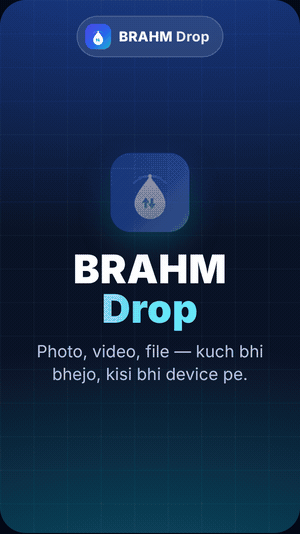

# BRAHM Drop

**Fast, private file transfer across your devices — over Wi-Fi, no internet, no login, no ads.**

Brahm InnerBrain Technologies Pvt. Ltd. · Developed by Sandeep Kushwah · v1.1

<p align="center">
  
</p>

> Animation not playing? GitHub occasionally pauses large GIFs — open
> [`docs/demo.gif`](docs/demo.gif), or the interactive version at
> [`docs/index.html`](docs/index.html).

---

## What it does

Move files between **Android ⇄ Windows**, **Android ⇄ Mac**, **Android ⇄ Android**
and **PC ⇄ PC** on the same Wi‑Fi. Files go **device-to-device** and never touch the
internet or any cloud. Devices find each other automatically. On the receiving
device nothing extra is needed — a phone can just **scan a QR and use the browser**
(installable as an app / PWA).

Built as a single self-contained program (Go). One codebase → Windows, macOS,
Linux/VPS. No runtime or installer dependencies.

## Features (v1.1)

- Automatic LAN device discovery (UDP, no central server)
- Device‑to‑device transfer of files and folders, multiple files at once
- **Web receiver / PWA** — the other device just opens a browser (no install); add to home screen for an app icon
- QR code to connect a phone instantly
- SHA‑256 integrity on every file
- Live transfer progress + transfer history
- Optional **Accept/Decline** prompt for incoming files (or auto‑accept)
- Add a device manually by IP (for networks that block broadcast)
- Safe filenames (path‑traversal protected), CORS for browser sending
- No login, no ads, no telemetry

## Downloads / how to run

| Platform | File | How |
|---|---|---|
| **Windows** (10/11, x64 & ARM) | `BRAHM-Drop-Windows-v1.1.zip` | unzip → double‑click **BRAHM Drop.exe** → Allow on Private network |
| **macOS** (Intel & Apple Silicon) | `BRAHM-Drop-Mac-v1.1.zip` | unzip → double‑click **BRAHM Drop.command** (right‑click → Open the first time) |
| **Linux / VPS** | `install-brahmdrop.sh` | `bash install-brahmdrop.sh` (runs on port 53330; `PORT=8080 bash install-brahmdrop.sh` for another port) |
| **Android / iPhone** | — | open the PC/Mac address (or scan its QR) in the phone browser; **Add to Home Screen** to install as an app |

On launch the app shows its address (e.g. `http://192.168.1.20:53330`) and a QR.
Received files are saved to **Downloads/BRAHM Drop** (configurable).

## Ports

- `53330/tcp` — web UI + file transfer
- `53331/udp` — device discovery

Allow these on your firewall for the local network. On a VPS, open the chosen TCP port.

## Build from source

```bash
# needs Go 1.24+
go build -o brahmdrop ./cmd/brahmdrop          # current OS
# cross-compile examples
GOOS=windows GOARCH=amd64 go build -o brahmdrop.exe ./cmd/brahmdrop
GOOS=darwin  GOARCH=arm64 go build -o brahmdrop-mac ./cmd/brahmdrop
```

The web UI and icons are embedded into the binary (`internal/server/web`).

## Project layout

```
cmd/brahmdrop/        entry point (flags, banner, browser open)
internal/config/      settings + device identity
internal/discovery/   UDP announce/listen peer discovery
internal/transfer/    history store + safe file saving (SHA-256)
internal/server/      HTTP API, send/receive, SSE, QR
internal/server/web/  web UI + PWA (embedded)
internal/netutil/     LAN IP detection
assets/               logo (SVG) + icon set
dist/                 packaging (installer, per-OS READMEs)
```

## Demo / UGC video (watch in a browser)

An animated 9:16 walkthrough of the app — what the UI looks like and what you
can send — lives at [`docs/index.html`](docs/index.html). It auto‑plays and loops,
so you can **screen‑record it as a UGC / reel video**, or just show it to anyone
to explain BRAHM Drop.

- **Open it live (no download):**
  https://htmlpreview.github.io/?https://raw.githubusercontent.com/yaandroid/BRAHMDrop/main/docs/index.html
- Or enable **GitHub Pages** (Settings → Pages → Branch: `main`, folder `/docs`)
  and it will be served at `https://yaandroid.github.io/BRAHMDrop/`.
- To record: open the page, frame the phone/stage (the Replay button sits outside
  the 9:16 area, so it won’t appear in the recording), and screen‑record.

## Remote desktop (AnyDesk‑style, Phase 3)

Turn on **Remote → “Allow this device to be controlled”** on the host; on the
other device open **Remote → “Control another device”**, enter the host address
and the 6‑digit pairing code. You get a live screen view and full mouse/keyboard
control, device‑to‑device over Wi‑Fi.

- Transport: MJPEG screen stream + input events over HTTP (no external deps).
- Screen capture & input injection: **Windows** uses a native backend (GDI +
  SendInput, pure Go). A macOS CoreGraphics backend is included in the source
  (built with cgo) and is being finalised for recent macOS SDKs; the shipped
  macOS build currently uses the portable backend. Other platforms use the
  portable backend.

## Android app

A native Android app (`android/`) wraps the Go server as a foreground service
(shipped as `libbrahmdrop.so` per ABI) and shows the web UI in a WebView, with a
system file‑picker for sending. Package `com.brahm.drop`, versionName **1.1**.

## Continuous builds (GitHub Actions)

`.github/workflows/build.yml` builds everything on push:
- **APK** (`BRAHM-Drop-v1.1.apk`) — Go server per ABI + Gradle assemble.
- **Desktop** — Windows, macOS (Intel + Apple Silicon, cgo), Linux.

Download them from the workflow run’s **Artifacts**.

## Roadmap

- Android ⇄ Android app‑to‑app background receive
- Resume of interrupted transfers
- End‑to‑end encryption on the wire
- Internet (relay) mode via a VPS coturn/relay when devices aren’t on one Wi‑Fi

---

© Brahm InnerBrain Technologies Pvt. Ltd. — Developed by Sandeep Kushwah.
